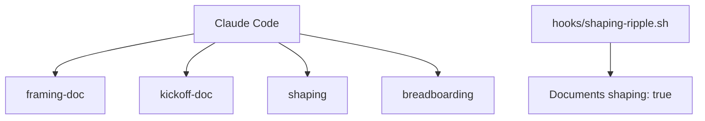

# rjs/shaping-skills

> Skills Claude Code pour cadrer un projet et cartographier un système, d'après la méthode Shape Up.

## Le problème
Transformer des conversations d'équipe en documents de cadrage exploitables prend du temps, et un LLM seul reste vague.

## Ce que ça fait vraiment
- `/framing-doc` et `/kickoff-doc` convertissent des transcriptions en documents de cadrage et de lancement.
- `/shaping` sépare le problème (besoins) de la solution (formes) avec des contrôles d'adéquation.
- `/breadboarding` décrit un système en affordances d'interface, de code et liaisons.
- Un hook PostToolUse rappelle de vérifier les effets de bord à l'édition de documents `shaping: true`.

## Comment c'est branché


## Essayer
```bash
git clone https://github.com/rjs/shaping-skills.git ~/.local/share/shaping-skills
ln -s ~/.local/share/shaping-skills/shaping ~/.claude/skills/shaping
ln -s ~/.local/share/shaping-skills/hooks/shaping-ripple.sh ~/.claude/hooks/shaping-ripple.sh
```

## Coût et pièges
Gratuit, mais sans licence déclarée : droits de réutilisation flous. Les skills « de document » reprennent mot pour mot la qualité de l'entrée.

## Ce que ce n'est pas
Pas maintenu : l'auteur écrit que ces skills sont obsolètes depuis l'époque d'Opus 4.6.

## Alternatives
Aucune alternative nommée dans le README.

## Pour toi
À ignorer : l'auteur lui-même les juge obsolètes, sans licence et archivés ; seule l'idée du hook de rappel est à emprunter.

