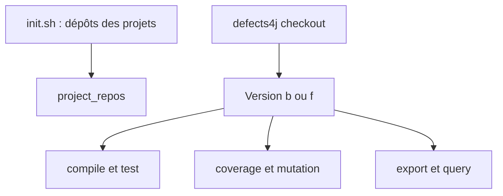

# rjust/defects4j

> Collection of 854 reproducible Java bugs and tooling for software engineering research.

## The problem
Evaluating a testing, fault localization or automated repair tool requires real, reproducible bugs, not made-up cases.

## What it actually does
Provides 854 active bugs drawn from 17 Java projects (jfreechart, commons-lang, closure-compiler, etc.). Each bug has a faulty version `b` and a fixed version `f`, with a test that fails before and passes after. A `defects4j` command lets you check out, compile, test, and measure coverage and mutation.

## How it is wired
Simplified diagram based on the fiche, no diagram provided.


## Trying it
```bash
git clone https://github.com/rjust/defects4j
cd defects4j
cpanm --installdeps .
./init.sh
export PATH=$PATH:"path2defects4j"/framework/bin
defects4j info -p Lang
defects4j checkout -p Lang -v 1b -w /tmp/lang_1_buggy
```

## Cost and gotchas
Java 11, Git, Subversion, Perl and `cpanm`. Initialization downloads the projects' repositories. The `America/Los_Angeles` time zone is required outside the framework.

## What it is not
It is not a repair tool: it provides the bugs, not automatic fixes. Ten bugs are already deprecated.

## Alternatives
No alternative named in the README.

## For you
Keep an eye on it: a benchmark reference if you evaluate code-repair agents, but limited to Java.
