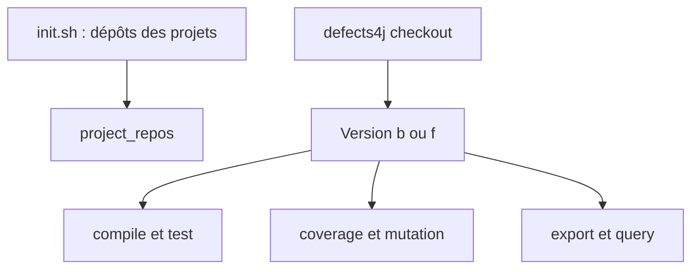

# rjust/defects4j

> Collection de 854 bogues Java reproductibles et outillage pour la recherche en génie logiciel.

## Le problème
Évaluer un outil de test, de localisation de fautes ou de réparation automatique exige de vrais bogues reproductibles, pas des cas inventés.

## Ce que ça fait vraiment
Fournit 854 bogues actifs tirés de 17 projets Java (jfreechart, commons-lang, closure-compiler, etc.). Chaque bogue a une version fautive `b` et une version corrigée `f`, avec un test qui échoue avant et passe après. Une commande `defects4j` permet d'extraire, compiler, tester, mesurer la couverture et la mutation.

## Comment c'est branché
Schéma simplifié d'après la fiche, sans diagramme fourni.


## Essayer
```bash
git clone https://github.com/rjust/defects4j
cd defects4j
cpanm --installdeps .
./init.sh
export PATH=$PATH:"path2defects4j"/framework/bin
defects4j info -p Lang
defects4j checkout -p Lang -v 1b -w /tmp/lang_1_buggy
```

## Coût et pièges
Java 11, Git, Subversion, Perl et `cpanm`. L'initialisation télécharge les dépôts des projets. Le fuseau `America/Los_Angeles` est requis hors du cadre.

## Ce que ce n'est pas
Ce n'est pas un outil de réparation : il fournit les bogues, pas les correctifs automatiques. Dix bogues sont déjà dépréciés.

## Alternatives
Aucune alternative nommée dans le README.

## Pour toi
À surveiller : référence de benchmark si tu évalues des agents de réparation de code, mais limité à Java.

