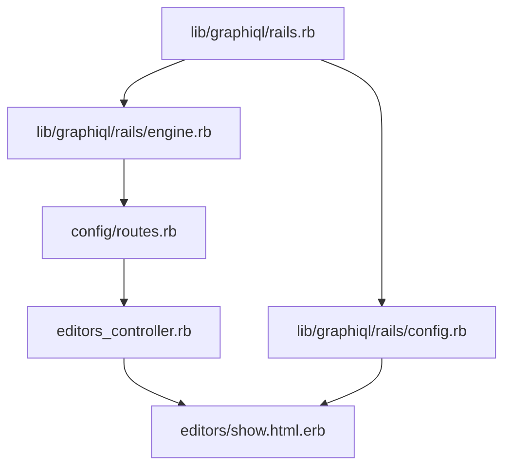

# rmosolgo/graphiql-rails

> Rails gem that mounts the GraphiQL IDE in an application, to query a GraphQL endpoint.

## The problem
Testing a GraphQL schema requires a separate tool, with no access to the application's authentication.

## What it actually does
A Rails engine (`engine.rb`) registers routes to `editors_controller`, which renders `show.html.erb`, configured by `config.rb`. Options: computed headers, CSRF token, header editor, initial query, persistence in the URL.

## How it is wired


## Trying it
```bash
bundle add graphiql-rails
# config/routes.rb :
# mount GraphiQL::Rails::Engine, at: "/graphiql", graphql_path: "/your/endpoint"
rake test
yarn run build
```

## Cost and gotchas
Free. Mount in development only (the README wraps it in `Rails.env.development?`). Requires Ruby on Rails, which is missing from the prerequisites list.

## What it is not
Not a GraphQL server: only the interface.

## Alternatives
No alternative named in the README.

## For you
Ignore: relevant only for a GraphQL API on Rails, outside your scope.
