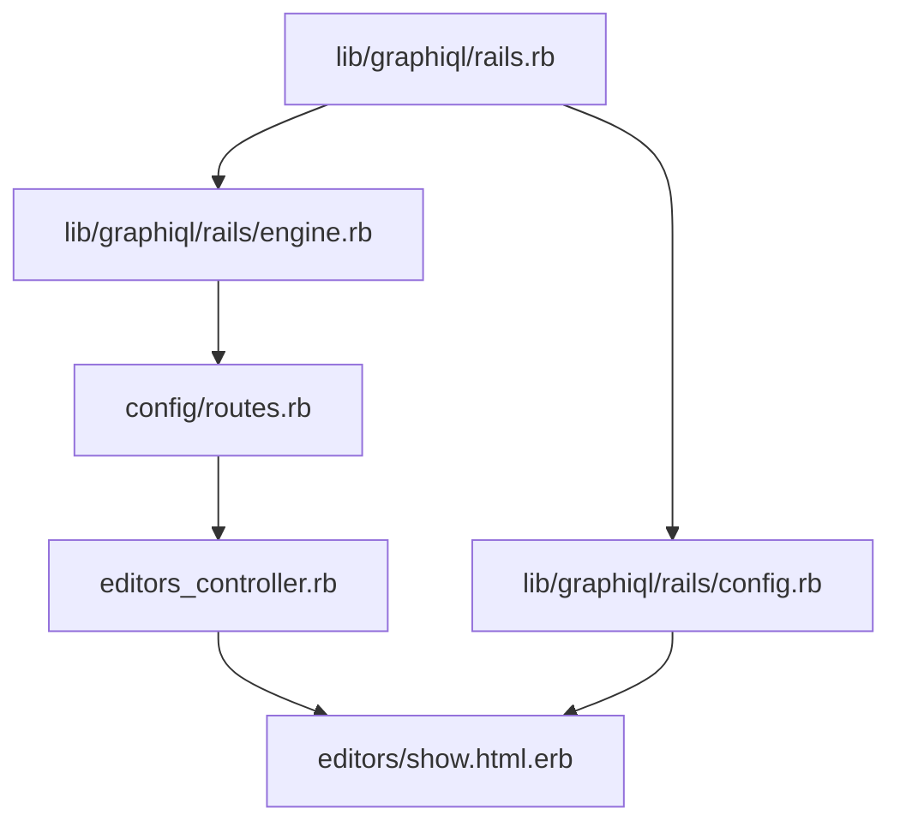

# rmosolgo/graphiql-rails

> Gem Rails qui monte l'IDE GraphiQL dans une application, pour interroger un point d'accès GraphQL.

## Le problème
Tester un schéma GraphQL demande un outil séparé, sans accès à l'authentification de l'application.

## Ce que ça fait vraiment
Un moteur Rails (`engine.rb`) enregistre des routes vers `editors_controller`, qui affiche `show.html.erb`, paramétré par `config.rb`. Options : en-têtes calculés, jeton CSRF, éditeur d'en-têtes, requête initiale, persistance dans l'URL.

## Comment c'est branché


## Essayer
```bash
bundle add graphiql-rails
# config/routes.rb :
# mount GraphiQL::Rails::Engine, at: "/graphiql", graphql_path: "/your/endpoint"
rake test
yarn run build
```

## Coût et pièges
Gratuit. À monter en développement uniquement (le README l'encadre par `Rails.env.development?`). Nécessite Ruby on Rails, absent de la liste des prérequis.

## Ce que ce n'est pas
Pas un serveur GraphQL : seulement l'interface.

## Alternatives
Aucune alternative nommée dans le README.

## Pour toi
Ignorer : pertinent seulement pour une API GraphQL sous Rails, hors de ton périmètre.

