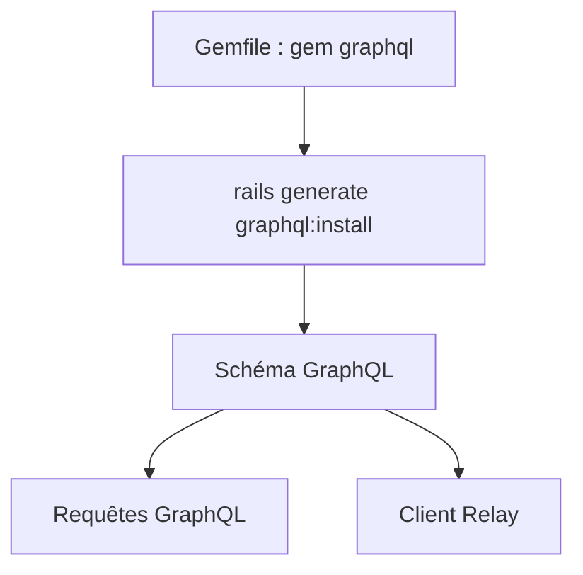

# rmosolgo/graphql-ruby

> Ruby implementation of GraphQL for Rails applications, compatible with the Relay client.

## The problem
Exposing a GraphQL API from a Ruby application without rewriting query parsing and schema execution.

## What it actually does
The `graphql` gem implements the GraphQL specification with an idiomatic Ruby API, close to the reference implementation, and supports Rails and Relay. A generator (`rails generate graphql:install`) sets up the basic structure and adds graphiql-rails. The README stays short and points to the website for details.

## How it is wired

Simplified diagram based on the sheet, no diagram provided.

## Trying it
```bash
bundle install
rails generate graphql:install
```
In the Gemfile: `gem 'graphql'`.

## Cost and gotchas
Free for the core. The maintainer sells GraphQL::Pro (persisted queries, API versioning, server-side caching, rate limiters, subscriptions, Pundit and CanCan plugins). Ruby or Rails is required.

## What it is not
It is not a GraphQL client or a standalone server. Advanced features are in the paid Pro version.

## Alternatives
No alternative named in the README.

## For you
Ignore: only useful if your backend is in Ruby; on the Python side, you would pick a GraphQL library from your own ecosystem.
