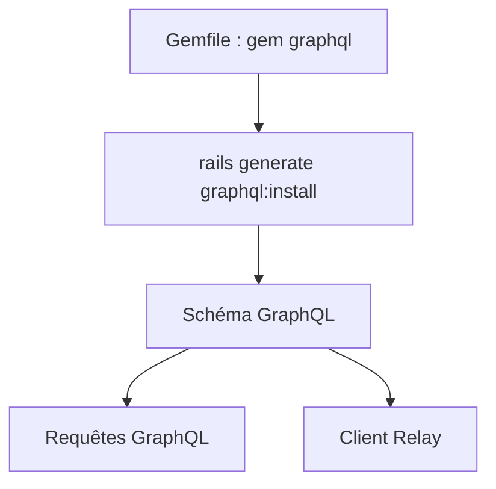

# rmosolgo/graphql-ruby

> Implémentation Ruby de GraphQL pour applications Rails, compatible avec le client Relay.

## Le problème
Exposer une API GraphQL depuis une application Ruby sans réécrire l'analyse des requêtes et l'exécution du schéma.

## Ce que ça fait vraiment
La gem `graphql` implémente la spécification GraphQL avec une API Ruby idiomatique, proche de l'implémentation de référence, et prend en charge Rails et Relay. Un générateur (`rails generate graphql:install`) installe la structure de base et ajoute graphiql-rails. Le README reste court et renvoie au site pour le détail.

## Comment c'est branché

Schéma simplifié d'après la fiche, sans diagramme fourni.

## Essayer
```bash
bundle install
rails generate graphql:install
```
Dans le Gemfile : `gem 'graphql'`.

## Coût et pièges
Gratuit pour le noyau. Le mainteneur vend GraphQL::Pro (requêtes persistées, versionnage d'API, mise en cache serveur, limiteurs de débit, abonnements, plugins Pundit et CanCan). Il faut Ruby ou Rails.

## Ce que ce n'est pas
Ce n'est pas un client GraphQL ni un serveur autonome. Les fonctions avancées sont dans la version Pro payante.

## Alternatives
Aucune alternative nommée dans le README.

## Pour toi
À ignorer : utile seulement si ton backend est en Ruby ; côté Python, tu prendras une bibliothèque GraphQL de ton écosystème.

