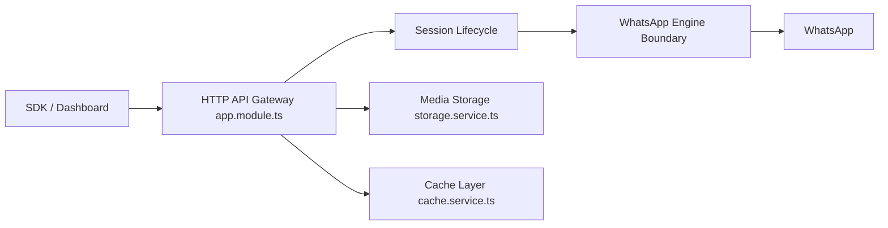

# rmyndharis/OpenWA

> Self-hosted WhatsApp gateway with a REST API, dashboard and MCP server, for developers.

## The problem
The official WhatsApp API is paid and restricted. To automate a number, you need a self-hosted gateway.

## What it actually does
Multi-session NestJS REST API on two unofficial engines (whatsapp-web.js, baileys). HMAC-signed webhooks, API keys scoped per session or per conversation, SQLite/PostgreSQL, optional Redis and S3, React dashboard, SDKs (JS, Python, Go, Java, PHP). An optional MCP server (`MCP_ENABLED=true`) exposes 25 tools read-only, 51 with `MCP_READONLY=false`.

## How it is wired


## Trying it
```bash
git clone https://github.com/rmyndharis/OpenWA.git
cd OpenWA
docker compose -f docker-compose.dev.yml up -d
docker exec openwa-api cat /app/data/.api-key
```

## Cost and gotchas
Free, but with a real risk of the number being banned: the README requires a dedicated number, a warm-up period and `SEND_PACING_ENABLED=true`. Chromium costs 300–500 MB per session. The Docker proxy gives host-root-equivalent access if compromised.

## What it is not
Not Meta's official API: the README advises against it for health, finance or GDPR use. Not affiliated with WhatsApp.

## Alternatives
- Meta's WhatsApp Cloud API: official, required in regulated environments.
- whatsapp-web.js / baileys: the engines used, without the gateway.

## For you
Worth watching: interesting for exposing WhatsApp to an agent via MCP in a prototype, with a throwaway number; too risky for product use.
