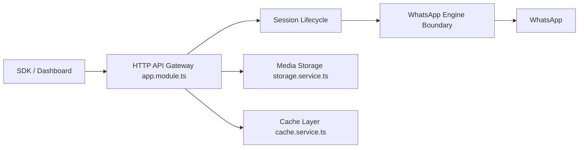

# rmyndharis/OpenWA

> Passerelle WhatsApp auto-hébergée avec API REST, tableau de bord et serveur MCP, pour développeurs.

## Le problème
L'API officielle WhatsApp est payante et encadrée. Pour automatiser un numéro, il faut une passerelle auto-hébergée.

## Ce que ça fait vraiment
API REST NestJS multi-sessions sur deux moteurs non officiels (whatsapp-web.js, baileys). Webhooks signés HMAC, clés d'API limitées par session ou par conversation, SQLite/PostgreSQL, Redis et S3 en option, tableau de bord React, SDK (JS, Python, Go, Java, PHP). Un serveur MCP optionnel (`MCP_ENABLED=true`) expose 25 outils en lecture, 51 avec `MCP_READONLY=false`.

## Comment c'est branché


## Essayer
```bash
git clone https://github.com/rmyndharis/OpenWA.git
cd OpenWA
docker compose -f docker-compose.dev.yml up -d
docker exec openwa-api cat /app/data/.api-key
```

## Coût et pièges
Gratuit, mais risque réel de bannissement du numéro : le README impose un numéro dédié, un échauffement et `SEND_PACING_ENABLED=true`. Chromium coûte 300–500 Mo par session. Le proxy Docker donne un accès équivalent root hôte s'il est compromis.

## Ce que ce n'est pas
Pas l'API officielle de Meta : le README le déconseille pour la santé, la finance ou le RGPD. Non affilié à WhatsApp.

## Alternatives
- WhatsApp Cloud API de Meta : officielle, requise en environnement réglementé.
- whatsapp-web.js / baileys : les moteurs utilisés, sans la passerelle.

## Pour toi
À surveiller : intéressant pour exposer WhatsApp à un agent via MCP en prototype, avec un numéro jetable ; trop risqué pour un usage produit.

