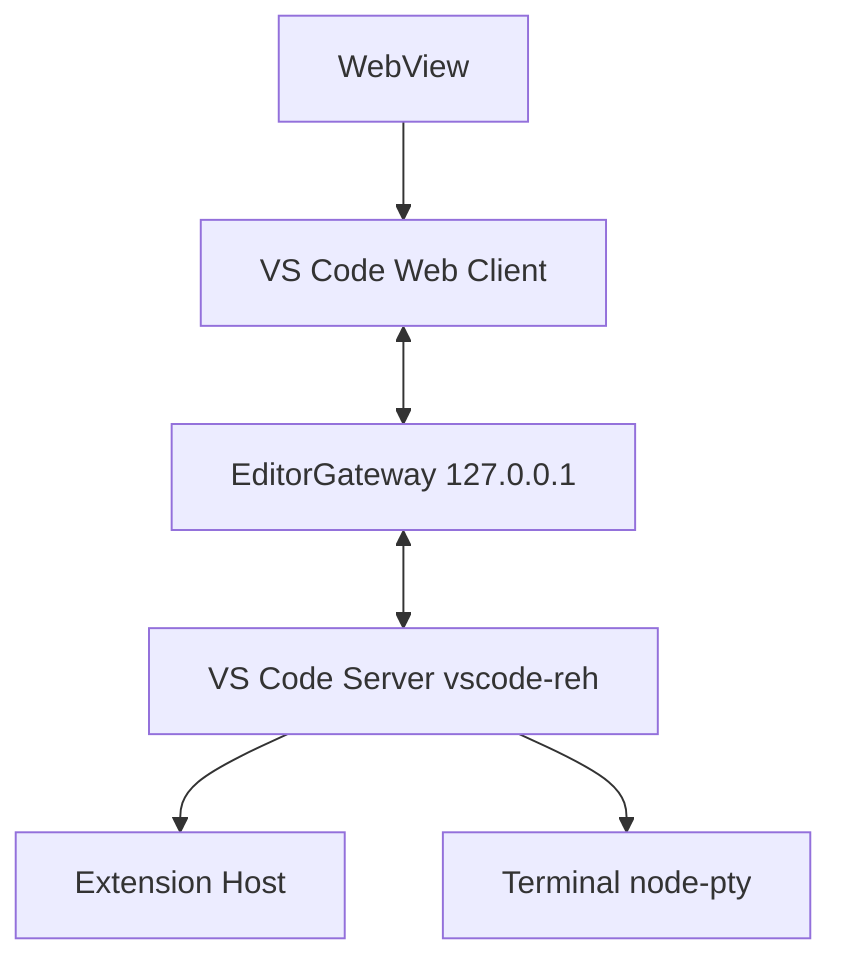

# rmyndharis/VSCodroid

> Full VS Code on Android, with terminal, Node, Python and Git, offline.

## The problem
Coding from a phone, without a laptop or a cloud IDE, with real tools.

## What it actually does
An Android application (Kotlin) runs a VS Code server locally (Node on ARM64) and displays the web client in a WebView. It bundles Node.js, Python 3, Git, SSH, tmux; Ruby, Java 21 and C/C++ are installed on demand. Extensions come from Open VSX.

## How it is wired


## Trying it
```bash
git clone https://github.com/rmyndharis/VSCodroid.git
cd VSCodroid
(cd android && ./gradlew assembleDebug)
adb install android/app/build/outputs/apk/debug/app-debug.apk
```

## Cost and gotchas
Android 11+, arm64, Chrome WebView 125+, 4 GB of RAM recommended, about 800 MB free (603 to 1,090 MB extracted). The local build only gives the shell: five NDK compilation scripts are also needed.

## What it is not
Not a Microsoft product nor an official VS Code (unaffiliated brand). Not a GPU nor a compute environment.

## Alternatives
No alternative named in the README.

## For you
Keep an eye on it: nice for getting out of a bind from a phone, but too constrained for data/AI work.
