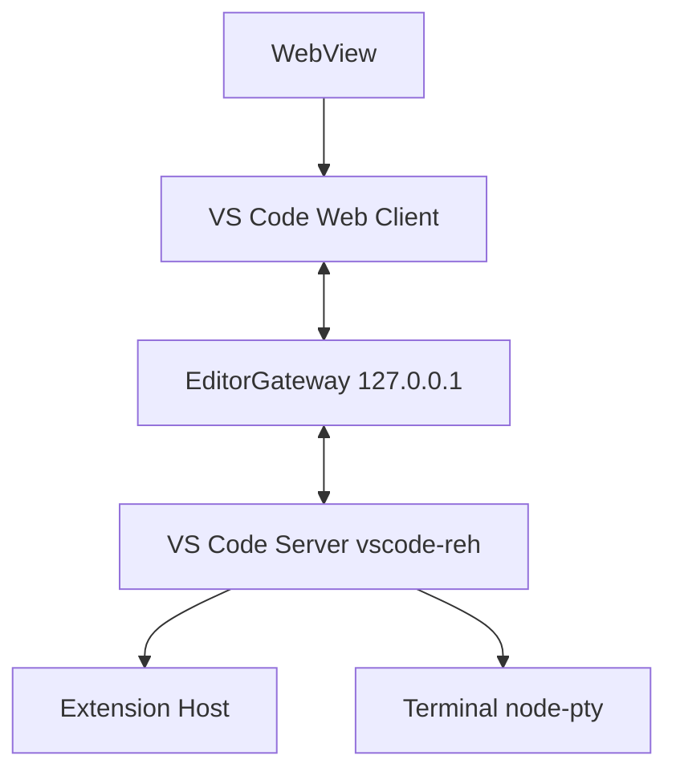

# rmyndharis/VSCodroid

> VS Code complet sur Android, avec terminal, Node, Python et Git, hors ligne.

## Le problème
Coder depuis un téléphone sans portable ni IDE cloud, avec de vrais outils.

## Ce que ça fait vraiment
Une application Android (Kotlin) lance localement un serveur VS Code (Node en ARM64) et affiche le client web dans une WebView. Elle embarque Node.js, Python 3, Git, SSH, tmux ; Ruby, Java 21 et C/C++ s'installent à la demande. Les extensions viennent d'Open VSX.

## Comment c'est branché


## Essayer
```bash
git clone https://github.com/rmyndharis/VSCodroid.git
cd VSCodroid
(cd android && ./gradlew assembleDebug)
adb install android/app/build/outputs/apk/debug/app-debug.apk
```

## Coût et pièges
Android 11+, arm64, WebView Chrome 125+, 4 Go de RAM conseillés, environ 800 Mo libres (de 603 à 1 090 Mo extraits). Le build local ne donne que la coquille : il faut aussi cinq scripts de compilation NDK.

## Ce que ce n'est pas
Pas un produit Microsoft ni un VS Code officiel (marque non affiliée). Pas un GPU ni un environnement de calcul.

## Alternatives
Aucune alternative nommée dans le README.

## Pour toi
Surveiller : sympathique pour dépanner depuis un téléphone, mais trop contraint pour du travail data/IA.

