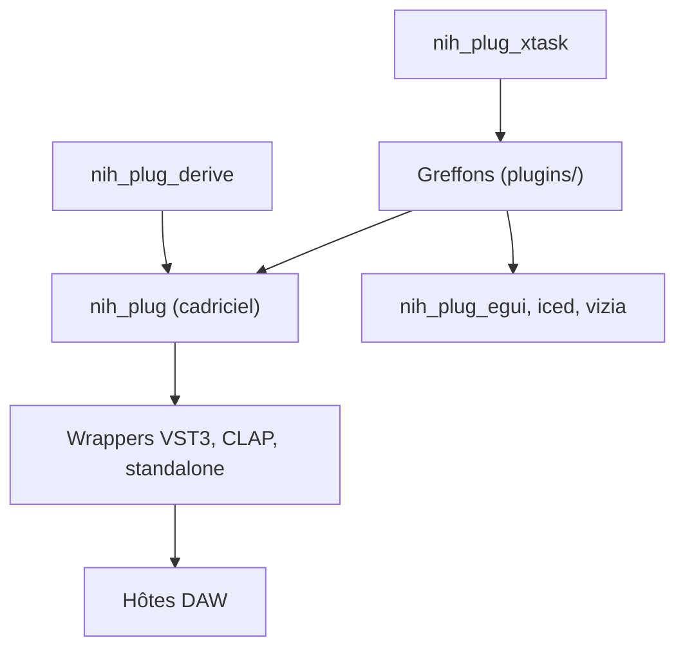

# robbert-vdh/nih-plug

> Rust framework for VST3 and CLAP audio plugins, with a small collection of example plugins.

## The problem
Writing an audio plugin with JUCE takes a lot of ceremony and repetitive code.

## What it actually does
A simple, stateful API: a `#[derive(Params)]` declares the parameters (floats, integers, booleans, enums) with smoothing and Serde persistence. The nih_export macros export VST3 or CLAP, or a standalone binary with JACK. It offers adapters for egui, iced and VIZIA, a real-time-safe background task executor and a `cargo xtask bundle` bundler.

## How it is wired


## Trying it
```bash
cargo xtask bundle gain --release
```

## Cost and gotchas
Free. The VST3 bindings are under GPLv3: a VST3 plugin must therefore comply with that license. The framework is in maintenance mode, and a community fork is indicated. Limited testing on macOS.

## What it is not
Not a machine-learning audio framework: it is for writing effects and instruments. Not actively extended: maintenance only.

## Alternatives
- The community fork cited at the top of the README (name not given in the text): preferable for a living framework.
- JUCE: cited as a point of comparison for the stateful behavior.

## For you
Ignore: an audio development tool unrelated to your field, and now in maintenance only.
