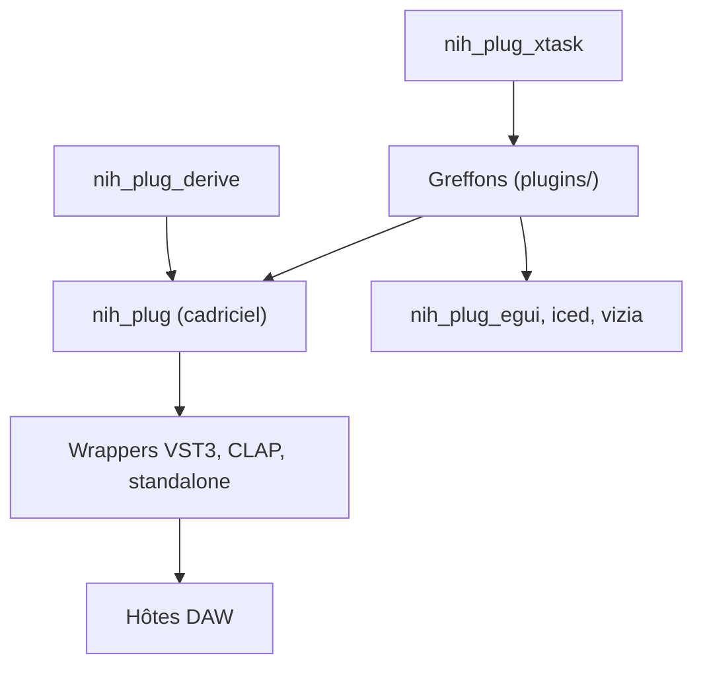

# robbert-vdh/nih-plug

> Cadriciel Rust de greffons audio VST3 et CLAP, avec une petite collection de greffons d'exemple.

## Le problème
Écrire un greffon audio avec JUCE demande beaucoup de cérémonie et de code répétitif.

## Ce que ça fait vraiment
Une API simple et à état : un `#[derive(Params)]` déclare les paramètres (flottants, entiers, booléens, énumérations) avec lissage et persistance Serde. Les macros nih_export exportent VST3 ou CLAP, ou un binaire autonome avec JACK. Il offre des adaptateurs pour egui, iced et VIZIA, un exécuteur de tâches de fond sûr en temps réel et un bundler `cargo xtask bundle`.

## Comment c'est branché


## Essayer
```bash
cargo xtask bundle gain --release
```

## Coût et pièges
Gratuit. Les liaisons VST3 sont sous GPLv3 : un greffon VST3 doit donc respecter cette licence. Le cadriciel est en mode maintenance, et un fork communautaire est indiqué. Test limité sur macOS.

## Ce que ce n'est pas
Pas un cadriciel d'apprentissage automatique audio : il sert à écrire des effets et instruments. Pas activement étendu : maintenance seulement.

## Alternatives
- Le fork communautaire cité en tête du README (nom non donné dans le texte) : à préférer pour un cadriciel vivant.
- JUCE : cité comme point de comparaison du comportement à état.

## Pour toi
Ignorer : outil de développement audio sans rapport avec ton métier, de plus en maintenance seule.

