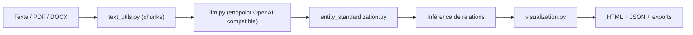

# robert-mcdermott/ai-knowledge-graph

> Turns text into an interactive knowledge graph by extracting triples with an LLM.

## The problem
A long document stays unreadable; seeing its entities and their relations, with the source sentence, means extracting everything by hand.

## What it actually does
Splits the text into chunks, has an LLM extract typed subject-predicate-object triples (with the original sentence), merges entity variants, adds inferred relations (flagged and capped), computes communities (Louvain) and produces a standalone HTML page. Exports to JSON, CSV, GraphML, Neo4j Cypher. Optional commands `graph-chat` (questions about the graph) and `graph-serve` (local interface). Works with any OpenAI-compatible endpoint, Ollama included. Disk cache of responses.

## How it is wired


## Trying it
```bash
git clone https://github.com/robert-mcdermott/ai-knowledge-graph.git
cd ai-knowledge-graph
uv sync --extra web
uv run graph-serve --config config.toml --graphs data/samples --open
uv run generate-graph --input your_text_file.txt --output knowledge_graph.html
uv run graph-chat knowledge_graph.json "How did the steam engine change cities?"
```

## Cost and gotchas
Free with a local Ollama; billed if you point to OpenAI or Gemini. Reasoning models can exhaust `max_tokens` (plan for 16-32k). `graph-serve` has no authentication: local use only. 170 tests without an LLM.

## What it is not
Not a graph database: the output is a static file. Rule-based inference (transitive, lexical) is disabled by default because it is noisy.

## Alternatives
Not documented in the README.

## For you
Adopt: examples testable without an LLM, traceability of triples and exports to Neo4j; it is a good testbed for entity extraction.
