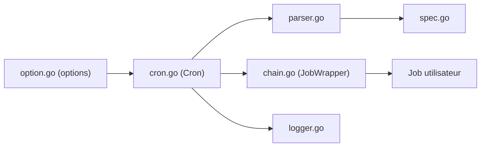

# robfig/cron

> Go library for cron-syntax job scheduling, in its versions 1, 2 and 3.

## The problem
Running Go code at regular intervals with cron syntax, handling time zones and overlapping jobs.

## What it actually does
You build a `Cron` object with functional options and add jobs to it with a cron expression (standard format by default, seconds optional for Quartz style). "Chains" (`Chain`, `JobWrapper`) add behaviors: recovering from panics, delaying or skipping a run if the previous one has not finished, logging. The time zone is set via `CRON_TZ`. Logging follows the `logr` interface.

## How it is wired


## Trying it
```bash
go get github.com/robfig/cron/v3@v3.0.0
```
Then `import "github.com/robfig/cron/v3"`. To keep v1's seconds field: `cron.New(cron.WithSeconds())`.

## Cost and gotchas
Free. The last push dates from July 2024, with 173 open issues. v3 breaks compatibility with v1 and v2: seconds field removed by default, no more automatic panic recovery, options passed at construction.

## What it is not
Not a distributed or persistent scheduler: jobs live in the process and are lost on restart. Not a data workflow tool.

## Alternatives
The README names no alternative; it only cites the standard cron format and Quartz's.

## For you
Ignore: a Go library with no direct use in data/AI/MLOps, and no update in over a year; reserve it for a Go service that needs a simple internal cron.
