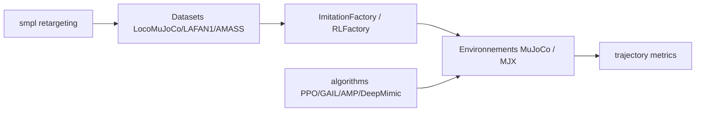

# robfiras/loco-mujoco

> Imitation learning benchmark for whole-body control of robots and human models.

## The problem
Comparing imitation algorithms on humanoids and quadrupeds means finding, adapting and replaying the same motion-capture data.

## What it actually does
MuJoCo environments (single) and MJX/MjWarp (parallel, on GPU): 12 humanoids, 4 quadrupeds, 4 biomechanical models. Over 22,000 mocap samples (LocoMuJoCo, LAFAN1, AMASS) retargeted per robot, single-file JAX algorithms (PPO, GAIL, AMP, DeepMimic), trajectory comparison metrics, a Gymnasium interface and domain randomization.

## How it is wired


## Trying it
```bash
cd loco-mujoco
pip install -e .
pip install jax["cuda12"]
loco-mujoco-set-all-caches --path "$HOME/.loco-mujoco-caches"
```

## Cost and gotchas
Free. Jax is installed in its CPU version by default; a GPU is required for MJX. AMASS is installed separately because of its license terms, and MyoSkeleton requires `loco-mujoco-myomodel-init` to accept its license.

## What it is not
Not a general-purpose simulator: an imitation benchmark. The PyPI package is not offered (installation from a clone).

## Alternatives
No alternative named in the README.

## For you
Worth watching: useful reference for RL and imitation in JAX, if robotics interests you; otherwise irrelevant.
