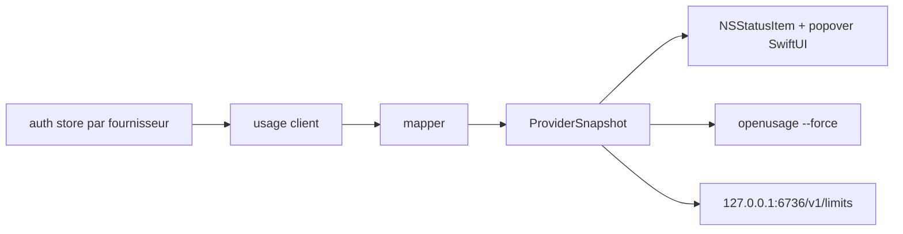

# robinebers/openusage

> macOS menu bar application that displays the consumption of your AI coding subscriptions.

## The problem
Each AI provider has its own quota screen, and none tells you where you stand overall.
You discover the limit has been reached in the middle of a session.

## What it actually does
A popover grouped by provider: session and weekly limits, credits, spending, countdowns.
Up to two pinned metrics per provider directly in the menu bar.
An `openusage` CLI that outputs stable JSON through the same five-minute cache, without the app running.
A local HTTP API at `127.0.0.1:6736/v1/limits`, on the loopback interface, which never serves credentials.

## How it is wired


## Trying it
```sh
brew install --cask openusage
```

## Cost and gotchas
Free, but macOS 15 (Sequoia) minimum: nothing for Linux or Windows.
The local API is readable by any open browser page; dSYMs are sent to PostHog on the build side.

## What it is not
Not a spending controller: it reads and displays, it blocks nothing.
Not cross-platform, despite the Apple Silicon/Intel universal binary.
The dollar amounts shown are estimates based on refreshed pricing, not your bill.

## Alternatives
No alternative named in the README.

## For you
You are on WSL2: unusable as is. Worth noting only for the idea of a local quota API.
