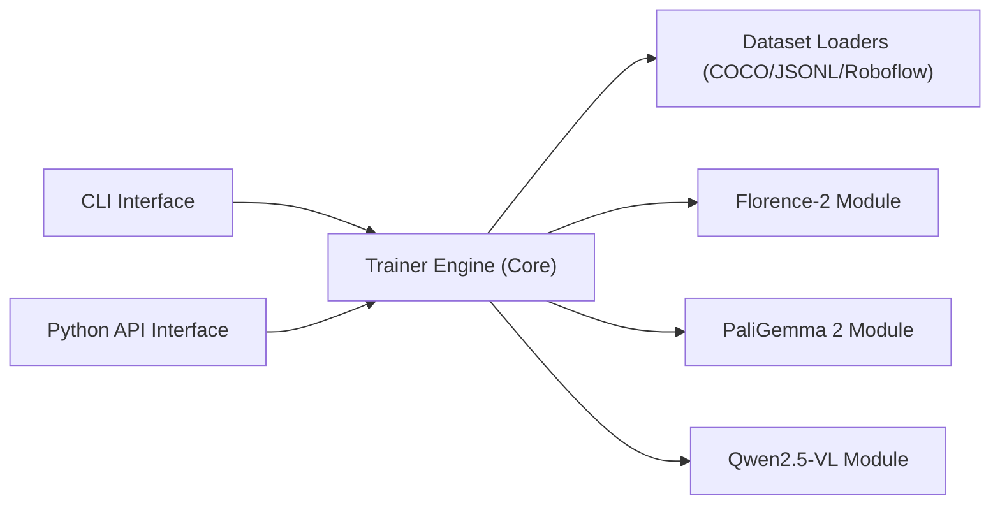

# roboflow/maestro

> Recipes for fine-tuning vision-language models (Florence-2, PaliGemma 2, Qwen2.5-VL), for ML engineers.

## The problem
Multimodal fine-tuning requires stitching together configuration, data loading, reproducibility and a training loop for each model.

## What it actually does
A CLI and a Python API launch a training run per model with LoRA or QLoRA; a shared module handles COCO/JSONL/Roboflow datasets, callbacks, seed, metrics and logging. Four Colab notebooks (detection, JSON extraction). Per-model dependencies, to be isolated in separate environments.

## How it is wired


## Trying it
```bash
pip install "maestro[paligemma_2]"
maestro paligemma_2 train \
  --dataset "dataset/location" \
  --epochs 10 \
  --batch-size 4 \
  --optimization_strategy "qlora" \
  --metrics "edit_distance"
```

## Cost and gotchas
A GPU is required (Colab possible for the cookbooks). Model dependencies can conflict with each other: one environment per model. Some recipes are marked experimental.

## What it is not
Not a general-purpose training framework: three model families. The README details neither hardware requirements nor results.

## Alternatives
No alternative named in the README.

## For you
Keep an eye on it: a clean starting point to fine-tune a VLM on your data, but coverage is limited to three models.
