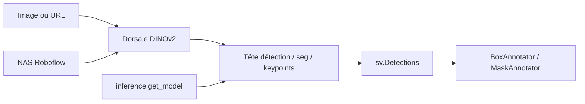

# roboflow/rf-detr

> Real-time object detection, instance segmentation and keypoints, transformer architecture.

## The problem
Most high-performing real-time detectors are under AGPL-3.0, which taints any proprietary product;
permissive alternatives lose accuracy at equal latency.

## What it actually does
Real-time DETR architecture built on a DINOv2 ViT backbone, with a single API for detection,
instance segmentation and keypoints (preview). Six sizes from N to 2XL, derived from a neural
architecture search. The `rfdetr` package and the N/S/M/L models are under **Apache 2.0**;
XL and 2XL go through the `rfdetr_plus` extension under PML 1.0. All segmentation sizes are
Apache 2.0. COCO measurements were made in-house on the 5,000 images of `val2017`, latencies on an NVIDIA T4
with TensorRT FP16, batch 1.

## How it is wired


## Trying it
```bash
pip install rfdetr
pip install rfdetr[plus]
pip install https://github.com/roboflow/rf-detr/archive/refs/heads/develop.zip
```

## Cost and gotchas
Python 3.10 minimum. The XL and 2XL sizes fall under the PML 1.0 license, not Apache: commercial
use must be checked. `COCO_CLASSES` only applies to COCO pre-trained models; on a fine-tuned model
you need `detections.data["class_name"]`. Training goes through Colab or the Roboflow platform.

## What it is not
Not entirely permissive: the core is, the largest models are not.
Keypoints are in **preview**. The figures quoted are not those of the competing authors but
in-house measurements, except lines marked † — comparable with each other, not necessarily with publications.

## Alternatives
- **YOLO11 / YOLO26**: lighter in parameters, but AGPL-3.0.
- **LW-DETR**: Apache 2.0, comparable latency.
- **D-FINE**: Apache 2.0, good accuracy/latency trade-off.

## For you
The detector to try when YOLO's AGPL blocks a client project.
