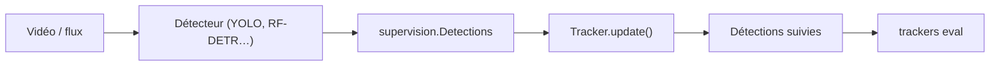

# roboflow/trackers

> Python object-tracking library (SORT, ByteTrack, OC-SORT, BoT-SORT, C-BIoU, McByte) compatible with supervision.

## The problem
Object identities get lost with occlusions, fast motion or a moving camera; reimplementing the algorithms is time-consuming.

## What it actually does
Six trackers reimplemented from the papers, with a common `update(detections, frame=None)` interface on `supervision.Detections`. CLI `trackers track`, `eval` (CLEAR, HOTA, Identity) and `download` (MOT17, SportsMOT), Optuna tuning via `trackers[tune]`. Reference results on four datasets.

## How it is wired


## Trying it
```bash
pip install trackers
trackers track \
    --source video.mp4 \
    --output.video output.mp4 \
    --detection.model rfdetr-medium \
    --tracker bytetrack \
    --show.labels \
    --show.trajectories
```

## Cost and gotchas
You must supply a detector (`inference` not included). McByte requires torch, SAM and Cutie. The MOT17 datasets are CC BY-NC-SA: non-commercial use.

## What it is not
The appearance/ReID branches of the papers are not included. The architecture block provided describes another project (the "New API" LLM gateway): discarded.

## Alternatives
- BoxMOT: under AGPL-3.0, cited by the README as a copyleft option.

## For you
Adopt if you do computer vision: the Apache-2.0 license and single interface make comparing algorithms easier.
