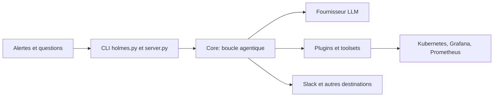

# robusta-dev/holmesgpt

> Open source AI agent that investigates production incidents and looks for the root cause.

## The problem
Faced with an alert, an SRE has to dig through logs, metrics and traces across ten tools before understanding anything.

## What it actually does
An agent loop queries live sources (Prometheus, Grafana, Datadog, Kubernetes, Loki, Tempo, SQL databases, MongoDB, Kafka, ArgoCD, GitHub, etc.) through "toolsets", then writes its analysis to Slack, Jira, PagerDuty or OpsGenie. Operator mode runs in the background under Kubernetes for scheduled health checks. Read-only access, respecting RBAC permissions.

## How it is wired

## Trying it
The README points to the installation documentation and usage guides: no command appears in it.

## Cost and gotchas
Works with any LLM provider (OpenAI, Anthropic, Azure, Bedrock, Gemini…): tokens are at your expense. The integrations require access to the observability systems.

## What it is not
Not an autonomous remediation tool by default: access is read-only. Operator mode and opening PRs require additional integrations. Not to be confused with Robusta, the original platform.

## Alternatives
- Robusta: the original platform, which provides the Slack and Teams integration.

## For you
Worth watching: relevant in MLOps to speed up diagnosis, CNCF sandbox project, but license not declared in the catalog.
