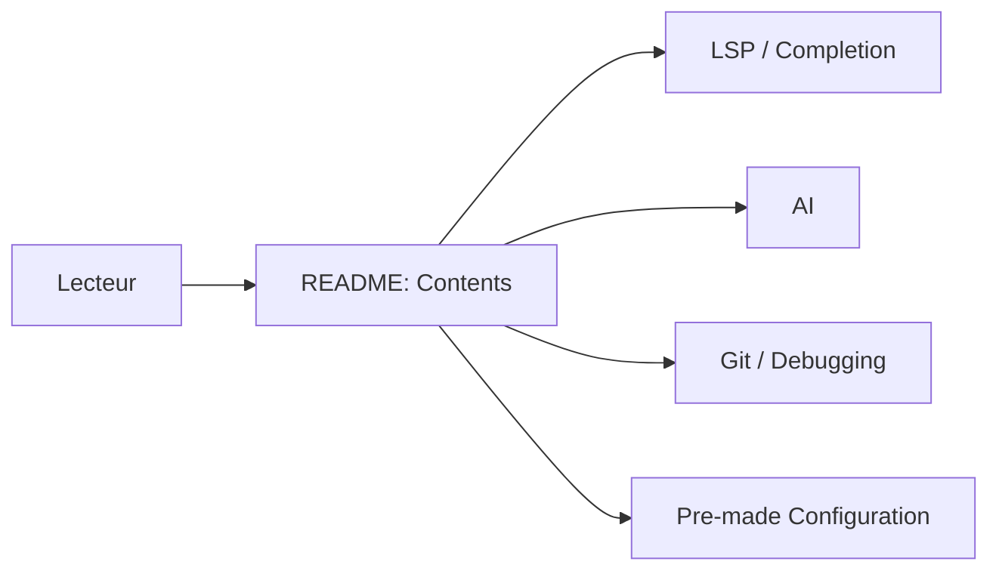

# rockerBOO/awesome-neovim

> Sorted list of Neovim (not Vim) plugins by category: LSP, completion, AI, Git, themes, etc.

## The problem
Finding the right Neovim plugin among thousands, without knowing which ones are maintained or specific to Neovim.

## What it actually does
An index of links by section (plugin managers, LSP, diagnostics, completion, AI, debugging, tests, Git, databases, distributions). The AI section lists integrations for Claude Code, Copilot, Ollama, Aider, VectorCode, codecompanion. Side sections: Jupyter (molten, jupytext-like), CSV.

## How it is wired

## Trying it
No command: browse the README and install the plugins with your manager (e.g. lazy.nvim).

## Cost and gotchas
Free. Each plugin has its own license and status; the list guarantees nothing. Many entries are recent.

## What it is not
Not a plugin nor a ready-to-use configuration (except the "Pre-made Configuration" section). No quality ranking.

## Alternatives
The repo cites Vimawesome, Neovimcraft, Dotfyle and Nvim.app as search sites.

## For you
Watch as a directory: useful if you edit your data code in Neovim (AI, Jupyter, DuckDB sections), otherwise worthless.
