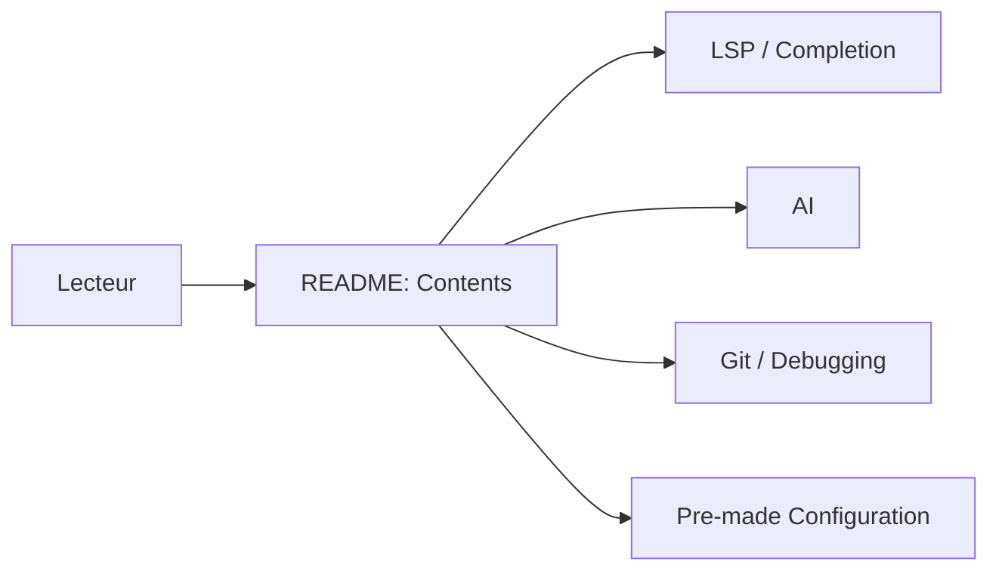

# rockerBOO/awesome-neovim

> Liste triée de plugins Neovim (pas Vim) par catégories : LSP, complétion, IA, Git, thèmes, etc.

## Le problème
Trouver le bon plugin Neovim parmi des milliers, sans savoir ce qui est maintenu ou propre à Neovim.

## Ce que ça fait vraiment
Index de liens par rubrique (gestionnaires de plugins, LSP, diagnostics, complétion, IA, débogage, tests, Git, bases de données, distributions). La rubrique IA recense des intégrations Claude Code, Copilot, Ollama, Aider, VectorCode, codecompanion. Rubriques annexes : Jupyter (molten, jupytext-like), CSV.

## Comment c'est branché

## Essayer
Aucune commande : parcourir le README et installer les plugins avec son gestionnaire (ex. lazy.nvim).

## Coût et pièges
Gratuit. Chaque plugin a sa licence et son état ; la liste ne garantit rien. Beaucoup d'entrées sont récentes.

## Ce que ce n'est pas
Pas un plugin ni une configuration prête à l'emploi (sauf la rubrique « Pre-made Configuration »). Pas de classement qualité.

## Alternatives
Dépôt cite Vimawesome, Neovimcraft, Dotfyle et Nvim.app comme sites de recherche.

## Pour toi
Surveiller comme annuaire : utile si tu édites ton code data dans Neovim (rubriques IA, Jupyter, DuckDB), sinon sans valeur.

