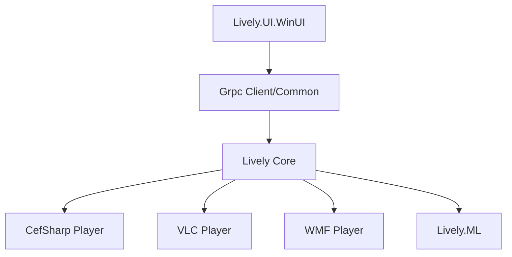

# rocksdanister/lively

> Animated wallpapers for Windows (video, web pages, games), for individual users.

## The problem
Windows does not offer animated or interactive wallpapers without third-party software.

## What it actually does
An engine launches specialized players (CefSharp, WebView2, VLC, WMF) as separate processes; the WinUI 3 interface drives them via gRPC. The wallpaper pauses when a window goes fullscreen, on battery, or in a remote desktop session. An ML module (MiDaS) is used for depth-based wallpapers.

## How it is wired


## Trying it
```bash
# Windows : Microsoft Store ou installateur (Windows 10 1903+), puis glisser-déposer un média
```

## Cost and gotchas
Free. Uses GPU; you need to go through the Store or the installer.

## What it is not
Not an ML tool, despite the mention of inference. Windows only.

## Alternatives
No alternative named.

## For you
Ignore: a desktop customization tool, outside the data/AI scope.
