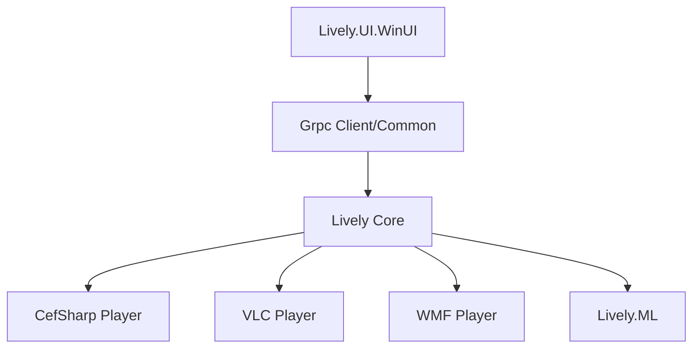

# rocksdanister/lively

> Fonds d'écran animés pour Windows (vidéo, pages web, jeux), pour particuliers.

## Le problème
Windows n'offre pas de fonds d'écran animés ou interactifs sans logiciel tiers.

## Ce que ça fait vraiment
Un moteur lance des lecteurs spécialisés (CefSharp, WebView2, VLC, WMF) comme processus séparés ; l'interface WinUI 3 les pilote via gRPC. Le fond se met en pause avec un plein écran, sur batterie ou en bureau distant. Un module ML (MiDaS) sert aux fonds basés sur la profondeur.

## Comment c'est branché


## Essayer
```bash
# Windows : Microsoft Store ou installateur (Windows 10 1903+), puis glisser-déposer un média
```

## Coût et pièges
Gratuit. Consomme du GPU ; compte à passer par le Store ou l'installateur.

## Ce que ce n'est pas
Pas un outil ML, malgré la mention d'inférence. Windows seulement.

## Alternatives
Aucune alternative nommée.

## Pour toi
Ignorer : outil de personnalisation de bureau, hors périmètre data/IA.

