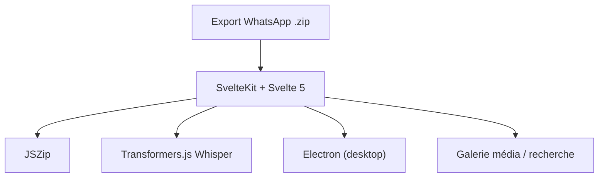

# rodrigogs/whats-reader

> Offline reader for WhatsApp exports (.zip) with a media gallery and local voice transcription, for individuals.

## The problem
A WhatsApp export is a zip of text and media, tedious to browse. Online readers force you to send your conversations to a third party.

## What it actually does
- You drop in the zip: messages, photos and voice notes show up in the browser or the Electron app.
- Media gallery by date, full-text search, bookmarks, "a participant's point of view" mode, statistics.
- Voice transcription with Whisper through Transformers.js (WebGPU), in the browser.
- Interface in ten languages, advertised as having no telemetry and no account.

## How it is wired
Simplified diagram based on the sheet, no diagram provided.


## Trying it
```bash
npm install
npm run dev
# puis ouvrir localhost:5173 et glisser le .zip
npm run electron:dev
```
Web version announced: rodrigogs.github.io/whats-reader.

## Cost and gotchas
Free. Node 18 or later to run from source; otherwise installers for Windows, macOS, Linux. Transcription requires WebGPU. On macOS, first launch via right-click "Open".

## What it is not
Not a data analysis or WhatsApp backup tool: it reads an export that already exists. AGPL-3.0 license, restrictive if you turn it into a service.

## Alternatives
No alternative cited in the README.

## For you
Ignore: a consumer tool outside your data / AI field, even though it is clean on privacy (local processing advertised).
