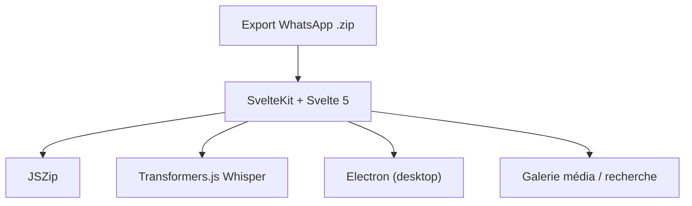

# rodrigogs/whats-reader

> Lecteur hors ligne d'exports WhatsApp (.zip) avec galerie média et transcription vocale locale, pour particuliers.

## Le problème
Un export WhatsApp est un zip de texte et de médias, pénible à parcourir. Les lecteurs en ligne obligent à envoyer ses conversations à un tiers.

## Ce que ça fait vraiment
- Tu déposes le zip : messages, photos et notes vocales s'affichent dans le navigateur ou l'appli Electron.
- Galerie média par date, recherche plein texte, signets, mode « point de vue d'un participant », statistiques.
- Transcription vocale avec Whisper via Transformers.js (WebGPU), dans le navigateur.
- Interface en dix langues, annoncée sans télémétrie ni compte.

## Comment c'est branché
Schéma simplifié d'après la fiche, sans diagramme fourni.


## Essayer
```bash
npm install
npm run dev
# puis ouvrir localhost:5173 et glisser le .zip
npm run electron:dev
```
Version web annoncée : rodrigogs.github.io/whats-reader.

## Coût et pièges
Gratuit. Node 18 ou plus pour lancer depuis les sources ; sinon installateurs Windows, macOS, Linux. La transcription demande WebGPU. Sur macOS, premier lancement par clic droit « Ouvrir ».

## Ce que ce n'est pas
Pas un outil d'analyse de données ni de sauvegarde WhatsApp : il lit un export déjà fait. Licence AGPL-3.0, contraignante si tu en fais un service.

## Alternatives
Aucune alternative citée dans le README.

## Pour toi
À ignorer : outil grand public hors de ton métier data / IA, même s'il est propre sur la confidentialité (traitement local annoncé).

