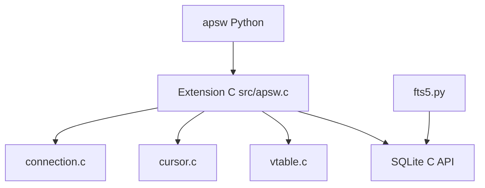

# rogerbinns/apsw

> Complete Python wrapper around SQLite's C API, for developers who want to use all of its features.

## The problem
Python's `sqlite3` module hides part of SQLite: virtual tables, VFS, sessions, full-text search.

## What it actually does
- Bridges SQLite's complete C API to Python's C API.
- Exposes FTS5 full-text search, sessions, virtual tables, VFS, JSON and CArray.
- Works in synchronous code and with asynchronous frameworks.
- Requires CPython 3.11 or later.

## How it is wired


## Trying it
```bash
pip install apsw
# Visite guidée : https://rogerbinns.github.io/apsw/example.html
```

## Cost and gotchas
Free. The README points to a license file described as "any OSI-approved open source license": check before redistributing.

## What it is not
Not interchangeable with other database drivers: the README recommends `sqlite3` for that.

## Alternatives
- Python's built-in `sqlite3` module, cited in the README, for a standard interface.

## For you
Worth watching: keep it in mind if you push SQLite far (FTS5, virtual tables) in a local data pipeline; otherwise `sqlite3` is enough.
