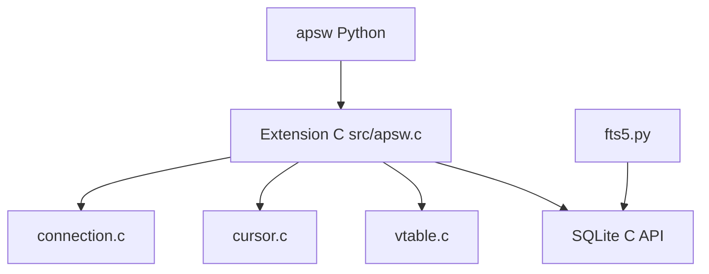

# rogerbinns/apsw

> Surcouche Python complète de l'API C de SQLite, pour développeurs voulant exploiter toutes ses fonctions.

## Le problème
Le module `sqlite3` de Python masque une partie de SQLite : tables virtuelles, VFS, sessions, recherche plein texte.

## Ce que ça fait vraiment
- Relie l'API C complète de SQLite à l'API C de Python.
- Expose recherche plein texte FTS5, sessions, tables virtuelles, VFS, JSON et CArray.
- Fonctionne en code synchrone et avec les frameworks asynchrones.
- Requiert CPython 3.11 ou plus.

## Comment c'est branché


## Essayer
```bash
pip install apsw
# Visite guidée : https://rogerbinns.github.io/apsw/example.html
```

## Coût et pièges
Gratuit. Le README renvoie à un fichier de licence décrit comme « n'importe quelle licence open source approuvée par l'OSI » : à vérifier avant redistribution.

## Ce que ce n'est pas
Pas interchangeable avec les autres pilotes de bases de données : le README recommande `sqlite3` pour cela.

## Alternatives
- Le module `sqlite3` intégré à Python, cité dans le README, pour une interface standard.

## Pour toi
À surveiller : à retenir si tu pousses SQLite loin (FTS5, tables virtuelles) dans un pipeline de données local ; sinon `sqlite3` suffit.

