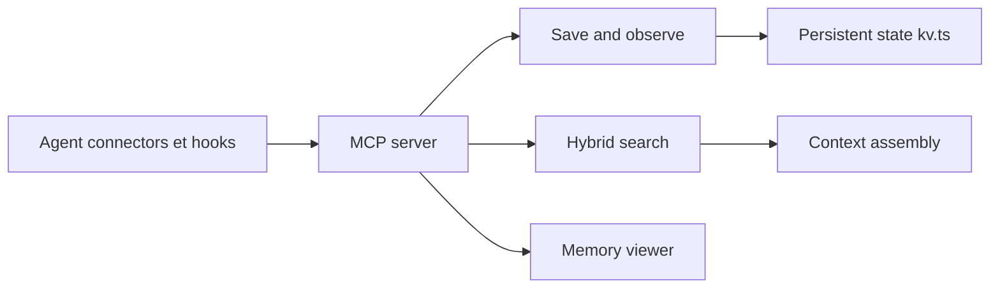

# rohitg00/agentmemory

> Persistent memory server that captures coding agent activity and re-injects it into the next session.

## The problem
Each new coding agent session starts from zero: architecture, decisions and preferences must be explained again.

## What it actually does
Hooks capture tool calls (privacy filter: secrets removed), compress them into observations and then into four-tier memory. BM25 search, optional vector search (`EMBEDDING_PROVIDER=local`) and graph search, merged by RRF. Exposes 54 MCP tools, a REST API (port 3111) and a viewer (3113). Works with 20+ agents. `iii` engine pinned at v0.22.1.

## How it is wired


## Trying it
```bash
npx -y @agentmemory/agentmemory@latest
npx -y @agentmemory/agentmemory@latest demo
npx skills add rohitg00/agentmemory -y
agentmemory connect <agent>
```

## Cost and gotchas
Free in keyless mode (BM25 only). LLM compression requires a provider and `AGENTMEMORY_AUTO_COMPRESS=true`, with token spend. Four ports to free up; native Windows requires installing `iii.exe` by hand. The benchmarks are the author's own.

## What it is not
Not a simple notes file: it is a daemon with local state. The comparisons with mem0, Letta, etc. mix different datasets (the README acknowledges this).

## Alternatives
mem0, Letta, Zep/Graphiti, Cognee (cited in the README).

## For you
Worth watching: it addresses a real gap in coding agents and stays local; adopt after trying the demo, since the surface (54 tools, pinned engine) is heavy for a one-person project.
