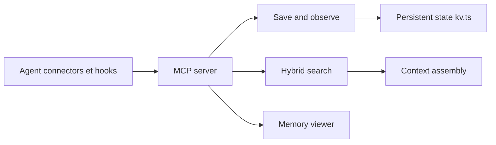

# rohitg00/agentmemory

> Serveur de mémoire persistante qui capture l'activité des agents de code et la réinjecte à la session suivante.

## Le problème
Chaque nouvelle session d'un agent de code repart de zéro : architecture, décisions et préférences sont à réexpliquer.

## Ce que ça fait vraiment
Des hooks capturent les appels d'outils (privacy filter : secrets retirés), les compressent en observations puis en mémoire à quatre niveaux. Recherche BM25, vectorielle optionnelle (`EMBEDDING_PROVIDER=local`) et graphe, fusionnées par RRF. Expose 54 outils MCP, une API REST (port 3111) et un visualiseur (3113). Fonctionne avec 20+ agents. Moteur `iii` épinglé en v0.22.1.

## Comment c'est branché


## Essayer
```bash
npx -y @agentmemory/agentmemory@latest
npx -y @agentmemory/agentmemory@latest demo
npx skills add rohitg00/agentmemory -y
agentmemory connect <agent>
```

## Coût et pièges
Gratuit en mode sans clé (BM25 seul). La compression par LLM exige un fournisseur et `AGENTMEMORY_AUTO_COMPRESS=true`, avec dépense de jetons. Quatre ports à libérer ; Windows natif demande d'installer `iii.exe` à la main. Les benchmarks sont ceux de l'auteur.

## Ce que ce n'est pas
Pas un simple fichier de notes : c'est un daemon avec état local. Les comparaisons avec mem0, Letta, etc. mélangent des jeux de données différents (le README le reconnaît).

## Alternatives
mem0, Letta, Zep/Graphiti, Cognee (cités dans le README).

## Pour toi
À surveiller : répond à un vrai manque des agents de code et reste local ; adopter après essai de la démo, car la surface (54 outils, moteur épinglé) est lourde pour un projet porté par une personne.

