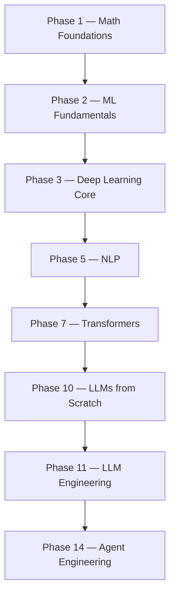

# rohitg00/ai-engineering-from-scratch

> A comprehensive course of 523 lessons to build AI from the ground up, from mathematics to agents.

## The problem
The available materials are scattered: one piece of paper here, a fine-tuning document there. We deliver a chatbot without knowing how to interpret its loss curve.

## What it actually does
20 modules, 523 lessons, ~342 hours, in Python, TypeScript, Rust, and Julia. Each lesson follows six steps, including a "Build It / Use It" pair: we implement the algorithm from basic math, then repeat the process using a production library. Each lesson produces a reusable artifact: a prompt, a skill, an agent, or an MCP server. Tutoring skills (`start-learning`, `learn`, `course-guide`, `learn-mcp`, `learn-agent-skills`, `claude-certification`) guide the progress, which is saved in `LEARNING.md`. The core curriculum is also compiled into six EPUB/PDF volumes.

## How it is wired

*(Accurate reproduction of the TB flowchart provided, which combines all 20 phases.)*

## Trying it
```bash
git clone https://github.com/rohitg00/ai-engineering-from-scratch.git
cd ai-engineering-from-scratch
python3 phases/00-setup-and-tooling/01-dev-environment/code/verify.py --route beginner
npx skills add rohitg00/ai-engineering-from-scratch
```

## Cost and gotchas
Free of charge, from MIT. Node.js and `npx` are required for the tutoring skills, `python3` for the executable labs; without them, the only option is to read the website or the `docs/en.md` file. The lessons can be accessed and read online without cloning, but the actual labs require cloning.

## What it is not
This is not a structured course: there are no videos, no copying and pasting, and no support. The Claude certification academy is an independent study material, not affiliated with Anthropic, and does not reproduce exam questions or guarantee any results. The certification curricula are not converted into books.

## Alternatives
No alternative is specified in the README file.

## For you
To be used as the core framework for skill development: phased learning allows you to directly access the level you need to improve.
