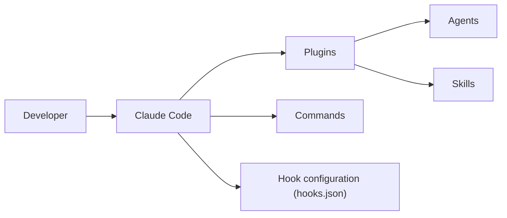

# rohitg00/awesome-claude-code-toolkit

> Catalog of agents, skills, commands, hooks and plugins for Claude Code, to pick from as needed.

## The problem
The Claude Code ecosystem is scattered: hard to find relevant hooks, agents or plugins.

## What it actually does
A collection advertising 135 agents in ten categories, 35 skills, 42 commands, 20 hooks, 15 rules, 7 CLAUDE.md templates, MCP configs and a long list of third-party plugins and apps with star counts. It is not an application: files are copied into `.claude/`.

## How it is wired


## Trying it
```bash
/plugin marketplace add rohitg00/awesome-claude-code-toolkit
cp -r commands/ .claude/commands/
cp hooks/hooks.json .claude/hooks.json
```

## Cost and gotchas
Free. The README also pushes a `curl | bash`. Hooks and plugins run code on your machine: review before installing. The figures (176+ plugins, 400,000 skills) are README claims.

## What it is not
Not a coherent product: an aggregator, with duplicates and entries of uneven quality. Descriptions come from third-party authors.

## Alternatives
- wshobson/agents, oh-my-claudecode, awesome-claude-code-subagents: cited in the README.

## For you
Keep an eye on it: a good source of hook and skill ideas, to be sorted yourself; do not install in bulk.
