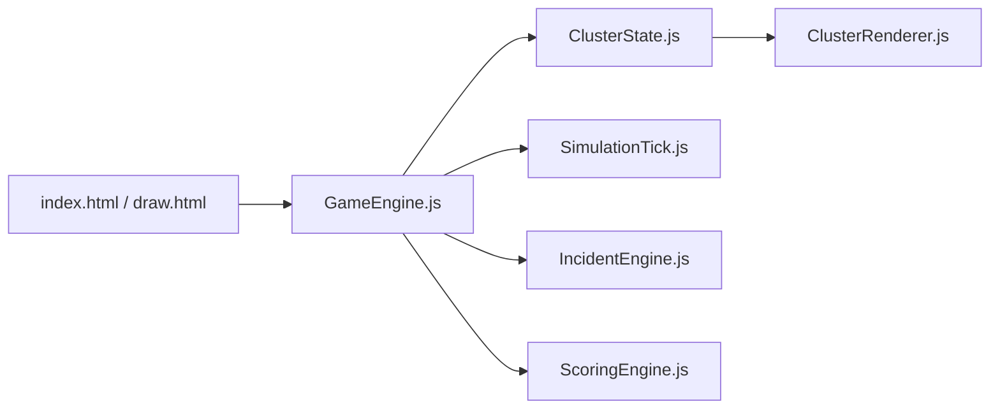

# rohitg00/k8sgames

> In-browser 3D simulator to learn Kubernetes by playing, with real kubectl commands.

## The problem
Learning to diagnose a CrashLoopBackOff or a NotReady node without risking a real cluster is hard.

## What it actually does
A game built with Three.js and ES modules, no build step: 25 resource types (Pod, Deployment, Service, RBAC…), 29 incidents, a kubectl command bar with completion, four modes (20-level campaign, chaos, sandbox, challenges) and an architecture score. A second tool, K8s Draw, serves as an architecture whiteboard with YAML or PNG export.

## How it is wired


## Trying it
```bash
git clone https://github.com/rohitg00/k8sgames.git
cd k8sgames
python3 -m http.server 8080
# Open http://localhost:8080
```

## Cost and gotchas
Free, no installation or account. Runs locally with a simple static server. Three.js and Tailwind are loaded from a CDN, so a connection is required.

## What it is not
Not a real cluster: the simulation is simplified, no real kubectl is executed. It does not replace practice on a real environment nor certification preparation.

## Alternatives
Excalidraw, cited as a point of comparison for K8s Draw.

## For you
Worth watching: a good Kubernetes onboarding aid for an MLOps team, at no cost, to try in a minute.
