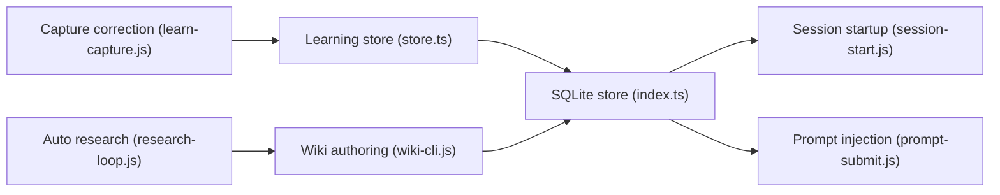

# rohitg00/pro-workflow

> Claude Code plugin that remembers your corrections and maintains searchable wikis in SQLite.

## The problem
You correct Claude the same way every session, and research is lost when the context is compacted.

## What it actually does
A SQLite store (FTS5) holds the rules drawn from your corrections, reloaded at session start. A "wiki" layer lets you create wikis by topic, queried with BM25 (hybrid with optional embeddings), fed by a budget-capped research loop and a multi-LLM council. On top come 41 skills, 8 agents, 23 commands and hooks (git/secrets guardrails, cost tracking).

## How it is wired


## Trying it
```bash
/plugin marketplace add rohitg00/pro-workflow
/plugin install pro-workflow@pro-workflow
/doctor
/wiki init agent-memory --title "Agent Memory" --flavor research
```

## Cost and gotchas
Free, but automatic research and the council consume API keys (adjustable budget, e.g. `--budget-usd 0.50`). An `npm install && npm run build` step is sometimes needed.

## What it is not
Not a measured product: the README's claims ("correction rate near zero") are not backed by figures. No license declared in the catalog.

## Alternatives
- Superpowers, ECC, gstack, GSD: competing suites cited in the README.

## For you
Worth watching: the idea of a corrections memory is useful, but the lack of a license and the very broad scope suggest picking a few skills rather than installing everything.
