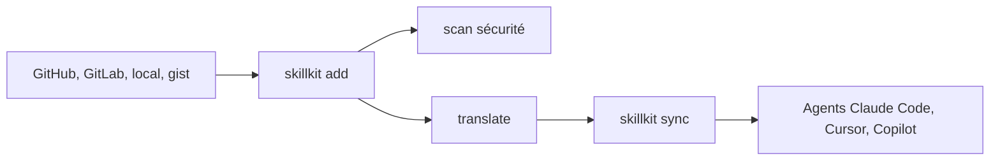

# rohitg00/skillkit

> Package manager for AI agent skills, which translates a skill into the format of 46 agents.

## The problem
Each coding agent has invented its own skill format and folder: you rewrite the same skill for each one.

## What it actually does
Installs skills from GitHub, GitLab, a local path or a gist, then translates (`translate`) and deploys (`sync`) them to the chosen agent. Adds recommendations based on the detected stack, a security scan and session memory. On top of that come a REST server, an MCP server, a TUI, a peer-to-peer network and AI skill generation.

## How it is wired

Simplified diagram based on the sheet, no diagram provided.

## Trying it
```bash
npx skillkit init
skillkit recommend
skillkit add anthropics/skills
skillkit sync
skillkit translate my-skill --to cursor
```

## Cost and gotchas
Free; AI skill generation requires a model (API key or local Ollama). The full installation pulls 418 packages, versus 118 with `--omit=optional`.

## What it is not
Not an in-house catalog: it aggregates third-party sources. The figures "400K+ skills" and "46 agents" come from the README, with no independent verification here.

## Alternatives
No alternative named in the README.

## For you
Worth watching: useful if you share skills across several agents, but the scope is very broad for a single maintainer.
