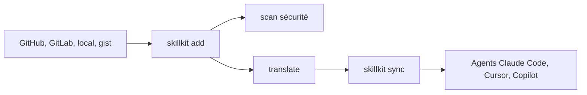

# rohitg00/skillkit

> Gestionnaire de paquets pour skills d'agents IA, qui traduit un skill vers le format de 46 agents.

## Le problème
Chaque agent de code a inventé son format de skill et son dossier : on réécrit le même skill pour chacun.

## Ce que ça fait vraiment
Installe des skills depuis GitHub, GitLab, un chemin local ou un gist, puis les traduit (`translate`) et les déploie (`sync`) vers l'agent choisi. Ajoute des recommandations selon la pile détectée, un scan de sécurité et une mémoire de session. S'y greffent un serveur REST, un serveur MCP, une TUI, un réseau pair à pair et une génération de skills par IA.

## Comment c'est branché

Schéma simplifié d'après la fiche, sans diagramme fourni.

## Essayer
```bash
npx skillkit init
skillkit recommend
skillkit add anthropics/skills
skillkit sync
skillkit translate my-skill --to cursor
```

## Coût et pièges
Gratuit ; la génération de skills par IA exige un modèle (clé d'API ou Ollama local). L'installation complète tire 418 paquets, contre 118 avec `--omit=optional`.

## Ce que ce n'est pas
Pas un catalogue maison : il agrège des sources tierces. Les chiffres « 400K+ skills » et « 46 agents » viennent du README, sans vérification indépendante ici.

## Alternatives
Aucune alternative nommée dans le README.

## Pour toi
À surveiller : utile si tu partages des skills entre plusieurs agents, mais le périmètre est très large pour un mainteneur seul.

