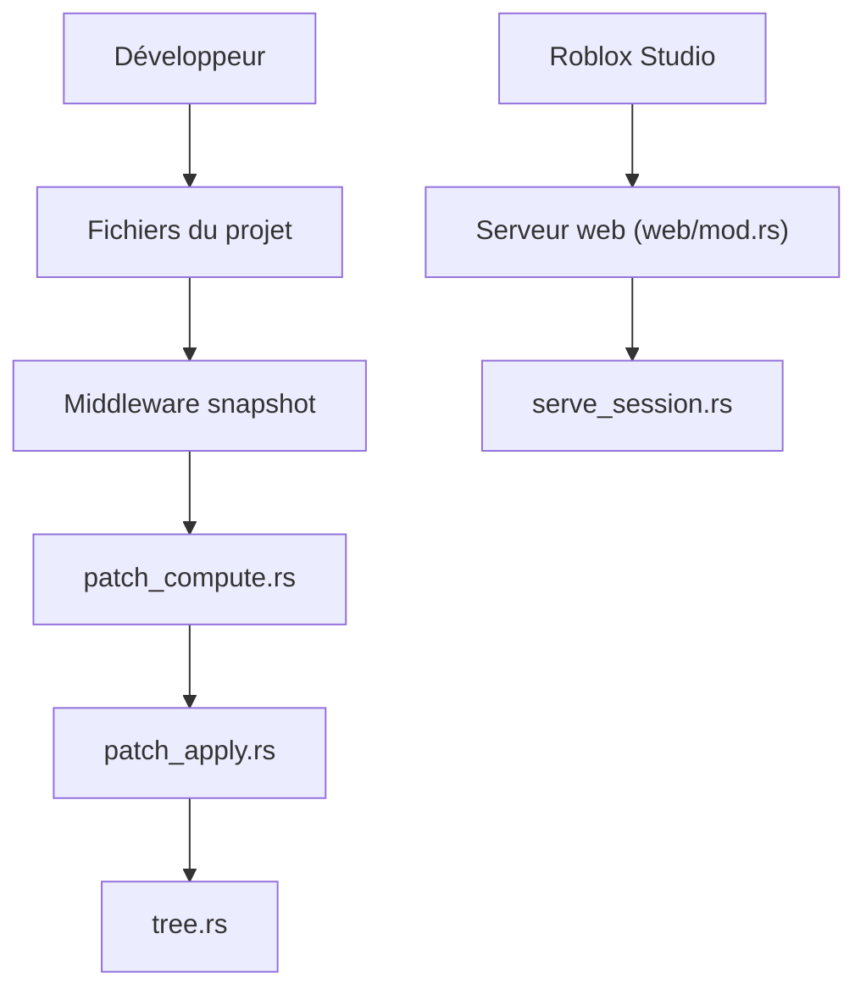

# rojo-rbx/rojo

> Tool that syncs a project on disk with Roblox Studio, so you can use VS Code and Git.

## The problem
Roblox Studio keeps scripts in its own files, with no Git or external editor.

## What it actually does
Turns files into a tree of Roblox instances, with live sync to a Studio plugin. Commands for build, deployment to Roblox.com, sourcemap, and `rojo syncback` to bring instances back to disk. Optional two-way sync.

## How it is wired


## Trying it
```bash
# No command documented in the README: documentation is on the rojo.space repository.
```

## Cost and gotchas
Free (MPL-2.0). Requires Roblox Studio and its plugin. Automatically converting an existing game remains limited and may require manual configuration.

## What it is not
Not a game engine or an editor: a bridge between disk and Studio.

## Alternatives
No alternative named in the README.

## For you
Ignore: Roblox development tool, unrelated to data, AI or MLOps.
