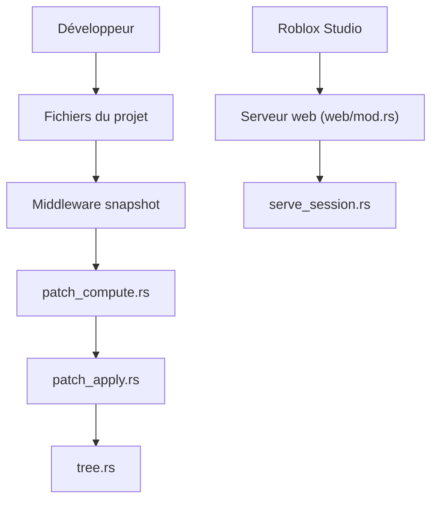

# rojo-rbx/rojo

> Outil qui synchronise un projet sur disque avec Roblox Studio, pour utiliser VS Code et Git.

## Le problème
Roblox Studio garde les scripts dans ses propres fichiers, sans Git ni éditeur externe.

## Ce que ça fait vraiment
Transforme des fichiers en arbre d'instances Roblox, avec une synchronisation en direct vers un plugin Studio. Commandes de build, de déploiement vers Roblox.com, de sourcemap et `rojo syncback` pour ramener les instances sur disque. Synchronisation bidirectionnelle optionnelle.

## Comment c'est branché


## Essayer
```bash
# Aucune commande documentée dans le README : documentation sur le dépôt rojo.space.
```

## Coût et pièges
Gratuit (MPL-2.0). Demande Roblox Studio et son plugin. Convertir automatiquement un jeu existant reste limité et peut exiger une configuration manuelle.

## Ce que ce n'est pas
Pas un moteur de jeu ni un éditeur : un pont entre le disque et Studio.

## Alternatives
Aucune alternative nommée dans le README.

## Pour toi
À ignorer : outil de développement Roblox, sans lien avec la data, l'IA ou le MLOps.

