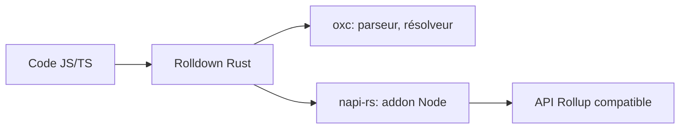

# rolldown/rolldown

> JavaScript/TypeScript bundler written in Rust, meant to become Vite's bundler, Rollup-compatible.

## The problem
JS bundlers written in JavaScript slow down builds; Vite wants a single, fast bundler.

## What it actually does
Rollup-compatible API and plugin interface, with a scope close to esbuild. Relies on napi-rs (Node addons) and on oxc (parser, resolver, sourcemaps). A project by VoidZero Inc. The README gives neither a command nor a benchmark.

## How it is wired

## Trying it
No command in the README; documentation at rolldown.rs.

## Cost and gotchas
Free. Maturity not stated in the README; 486 open issues.

## What it is not
Not a framework nor a dev server. Not yet presented as a stable Rollup replacement in the README ("intended to serve").

## Alternatives
Rollup and esbuild, cited as inspirations.

## For you
Keep an eye on it: a piece of the Vite chain that you will use without touching it, useful only for dashboards or web apps.
