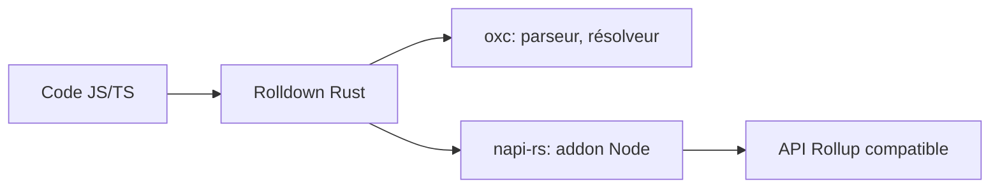

# rolldown/rolldown

> Bundler JavaScript/TypeScript écrit en Rust, destiné à devenir celui de Vite, compatible Rollup.

## Le problème
Les bundlers JS en JavaScript ralentissent les builds ; Vite veut un bundler unique et rapide.

## Ce que ça fait vraiment
API et interface de plugins compatibles Rollup, portée proche d'esbuild. S'appuie sur napi-rs (addons Node) et sur oxc (parseur, résolveur, sourcemaps). Projet de VoidZero Inc. Le README ne donne ni commande ni benchmark.

## Comment c'est branché

## Essayer
Aucune commande dans le README ; documentation sur rolldown.rs.

## Coût et pièges
Gratuit. Maturité non précisée dans le README ; 486 issues ouvertes.

## Ce que ce n'est pas
Pas un framework ni un serveur de dev. Pas encore présenté comme remplaçant stable de Rollup dans le README (« intended to serve »).

## Alternatives
Rollup et esbuild, cités comme inspirations.

## Pour toi
Surveiller : brique de la chaîne Vite que tu utiliseras sans y toucher, utile seulement pour des dashboards ou apps web.

