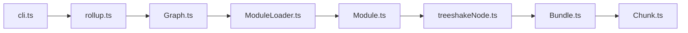

# rollup/rollup

> JavaScript bundler that assembles ES modules into one optimized file, for library and application authors.

## The problem
Shipping modular code to environments that do not handle ES modules, without bundling unused code.

## What it actually does
Takes an entry point, resolves and analyzes modules, removes unused code (tree shaking), then outputs chunks as iife, cjs, umd or ES. Usable from the CLI with a config file or through the JavaScript API. CommonJS modules go through a plugin; watch mode included.

## How it is wired


## Trying it
```bash
npm install --global rollup
rollup main.js --format iife --name "myBundle" --file bundle.js
rollup main.js --format cjs --file bundle.js
rollup main.js --format umd --name "myBundle" --file bundle.js
```

## Cost and gotchas
Free. The UMD format requires a bundle name. Importing CommonJS depends on a separate plugin.

## What it is not
Not a development server. The license is present but not identified by GitHub: to be checked.

## Alternatives
- webpack: cited in the README for the compatibility of published modules.

## For you
Worth watching: useful if you publish a JS library; otherwise unrelated to data or AI. Check the license.
