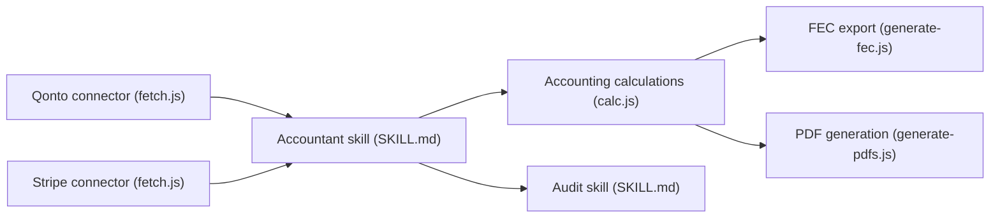

# romainsimon/paperasse

> Six Markdown skills for AI agents covering French accounting, taxation, notary work and condominium management.

## The problem
French accounting and tax procedures are dense, changing and error-prone.

## What it actually does
Six skills (`comptable`, `controleur-fiscal`, `commissaire-aux-comptes`, `fiscaliste`, `notaire`, `syndic`) with Node scripts and templates: journal entries, VAT, annual closing, FEC, tax return package, DGFIP audit simulation, tax calculations, notary fees. Optional Qonto and Stripe connectors. With/without-skill evaluations: 88% versus 75% in aggregate, measured by the author.

## How it is wired


## Trying it
```bash
npm install
cp company.example.json company.json
npm run fetch
npm run closing
uv run --project evals python evals/run_evals.py
```

## Cost and gotchas
The skills run with your agent's keys; Qonto and Stripe require API keys. Skills sharing symbolic links break when imported via zip.

## What it is not
Not a substitute for a chartered accountant, an auditor or a notary (disclaimer from the repository). Tax rules change: check the figures.

## Alternatives
No alternative named in the README (forks paperasse-tn and paperasse-be for other countries).

## For you
Ignore for a data/AI profile: a very specific French tax domain; only the skill evaluation setup may inspire you.
