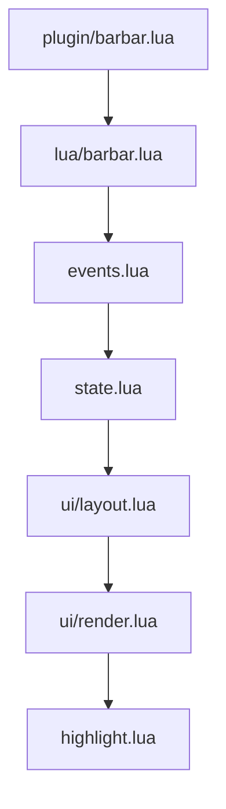

# romgrk/barbar.nvim

> Neovim plugin that displays a tab bar with reorderable, clickable tabs, icons and jump-by-letter.

## The problem
Neovim has no buffer tabs like other editors.

## What it actually does
Auto-sizing tab bar, reorderable, pinnable, with unique names when two files collide, a jump-by-letter mode, sorting, gitsigns and diagnostics integration, offset for sidebars. Restores order via sessions.

## How it is wired
Diagram based on the code diagram.



## Trying it
```bash
# README : pas de commande shell. Installation par gestionnaire de plugins, par exemple lazy.nvim :
# {'romgrk/barbar.nvim', dependencies = {...}, version = '^1.0.0'}
```

## Cost and gotchas
Free. Neovim 0.7+ required. No license declared: usage rights uncertain. Netrw not supported; a Nerd Font is recommended.

## What it is not
Not a status bar nor a file explorer.

## Alternatives
No alternative named in the README.

## For you
Ignore: editor comfort unrelated to the job, and no license.
