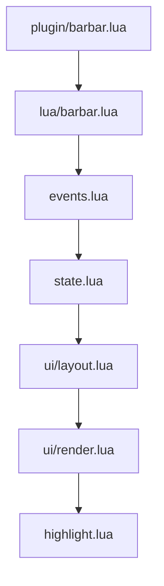

# romgrk/barbar.nvim

> Plugin Neovim qui affiche une barre d'onglets réordonnables, cliquables, avec icônes et saut par lettre.

## Le problème
Neovim n'a pas d'onglets de tampons comme les autres éditeurs.

## Ce que ça fait vraiment
Barre d'onglets à taille automatique, réordonnables, épinglables, avec noms uniques quand deux fichiers coïncident, mode de saut par lettre, tris, intégration gitsigns et diagnostics, décalage pour les barres latérales. Restaure l'ordre via les sessions.

## Comment c'est branché
Schéma d'après le diagramme du code.



## Essayer
```bash
# README : pas de commande shell. Installation par gestionnaire de plugins, par exemple lazy.nvim :
# {'romgrk/barbar.nvim', dependencies = {...}, version = '^1.0.0'}
```

## Coût et pièges
Gratuit. Neovim 0.7+ requis. Aucune licence déclarée : droits d'utilisation incertains. Netrw non supporté ; une police Nerd Font est recommandée.

## Ce que ce n'est pas
Pas une barre d'état ni un explorateur de fichiers.

## Alternatives
Aucune alternative nommée dans le README.

## Pour toi
À ignorer : confort d'éditeur sans lien avec le métier, et licence absente.

