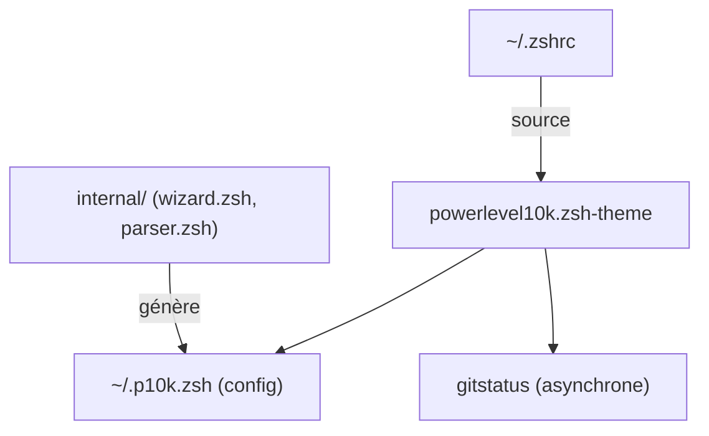

# romkatv/powerlevel10k

> Fast, configurable Zsh theme with a setup wizard, for those who live in their terminal.

## The problem
Zsh prompt themes slow down display and shell startup, especially with Git and several plugins.

## What it actually does
Displays a segmented prompt (directory, Git state, Python and Node environments, Kubernetes context, cloud…). A `p10k configure` wizard generates `~/.p10k.zsh`. The "instant prompt" shows the prompt before plugins finish loading. Git information is computed by an asynchronous module (`gitstatus`).

## How it is wired


## Trying it
```bash
git clone --depth=1 https://github.com/romkatv/powerlevel10k.git ~/powerlevel10k
echo 'source ~/powerlevel10k/powerlevel10k.zsh-theme' >>~/.zshrc
exec zsh
p10k configure
```

## Cost and gotchas
Free. A Nerd Font is needed (Meslo recommended) for all styles. The README warns: very limited support, no new features, most bugs will not be fixed.

## What it is not
Not a shell or a plugin manager. Not an actively developed project. The README is cut off in the middle of the font section: the end was not read.

## Alternatives
- Pure: minimal prompt, which Powerlevel10k can imitate.
- Powerlevel9k: ancestor whose configuration it reuses.

## For you
Watch: useful to see Python, Kubernetes or cloud context in the prompt, but the project is no longer evolving.
