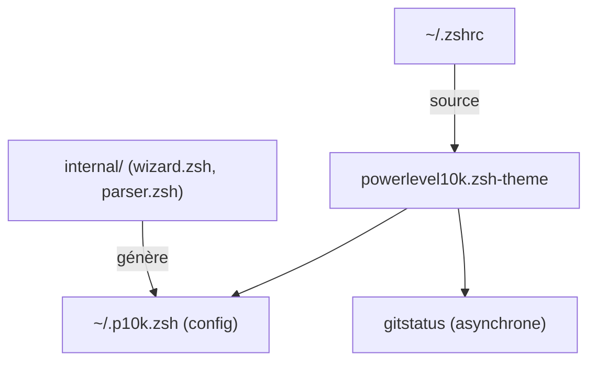

# romkatv/powerlevel10k

> Thème Zsh rapide et configurable, avec assistant de réglage, pour qui vit dans son terminal.

## Le problème
Les thèmes de prompt Zsh ralentissent l'affichage et le démarrage du shell, surtout avec Git et plusieurs plugins.

## Ce que ça fait vraiment
Affiche un prompt à segments (répertoire, état Git, environnements Python et Node, contexte Kubernetes, cloud…). Un assistant `p10k configure` génère `~/.p10k.zsh`. Le « prompt instantané » affiche le prompt avant la fin du chargement des plugins. Les informations Git sont calculées par un module asynchrone (`gitstatus`).

## Comment c'est branché


## Essayer
```bash
git clone --depth=1 https://github.com/romkatv/powerlevel10k.git ~/powerlevel10k
echo 'source ~/powerlevel10k/powerlevel10k.zsh-theme' >>~/.zshrc
exec zsh
p10k configure
```

## Coût et pièges
Gratuit. Il faut une police Nerd Font (Meslo recommandée) pour tous les styles. Le README prévient : support très limité, pas de nouvelles fonctions, la plupart des bugs ne seront pas corrigés.

## Ce que ce n'est pas
Pas un shell ni un gestionnaire de plugins. Pas un projet en développement actif. Le README est coupé en cours de section police : la fin n'a pas été lue.

## Alternatives
- Pure : prompt minimal, que Powerlevel10k sait imiter.
- Powerlevel9k : ancêtre dont il reprend la configuration.

## Pour toi
À surveiller : utile pour voir le contexte Python, Kubernetes ou cloud dans le prompt, mais le projet n'évolue plus.

