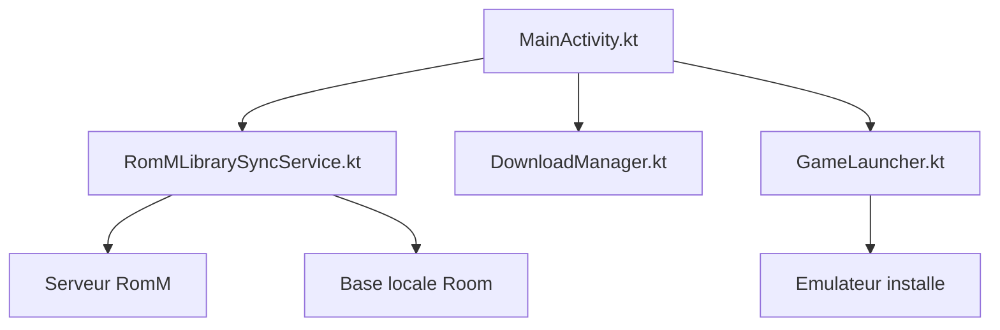

# rommapp/argosy-launcher

> Gamepad-driven Android launcher for retro handheld consoles, connected to a RomM server.

## The problem
Android handheld consoles have no gamepad-oriented interface nor game library synchronization.

## What it actually does
Syncs the library from RomM (or Jellyfin), downloads ROMs and BIOS, detects installed emulators and launches games. Syncs saves in both directions, shows RetroAchievements, manages collections and installed Steam games.

## How it is wired

## Trying it
No command: download the APK from the Releases, install it, follow the first-launch wizard.

## Cost and gotchas
Free, Android 8 minimum. A RomM server is optional but needed for synchronization. Emulators and ROMs are at your expense; 180 open issues.

## What it is not
Not an emulator, and it provides no games. Not a general-purpose launcher: the interface targets handheld consoles.

## Alternatives
No alternative cited in the README.

## For you
Ignore: unrelated to a data, AI or MLOps job, useful only for an Android handheld console.
