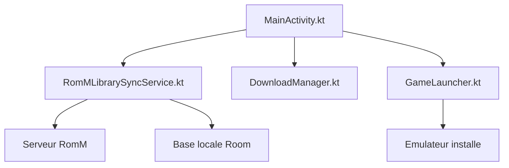

# rommapp/argosy-launcher

> Lanceur Android piloté à la manette pour consoles portables rétro, branché sur un serveur RomM.

## Le problème
Les consoles portables Android n'ont pas d'interface pensée pour la manette ni de synchronisation de bibliothèque de jeux.

## Ce que ça fait vraiment
Synchronise la bibliothèque depuis RomM (ou Jellyfin), télécharge ROMs et BIOS, détecte les émulateurs installés et lance les jeux. Synchronise les sauvegardes dans les deux sens, affiche les succès RetroAchievements, gère collections et jeux Steam installés.

## Comment c'est branché

## Essayer
Aucune commande : télécharger l'APK depuis les Releases, l'installer, suivre l'assistant de premier lancement.

## Coût et pièges
Gratuit, Android 8 minimum. Un serveur RomM est facultatif mais nécessaire à la synchronisation. Les émulateurs et les ROMs restent à ta charge ; 180 issues ouvertes.

## Ce que ce n'est pas
Pas un émulateur, et il ne fournit aucun jeu. Pas un lanceur généraliste : l'interface vise les consoles portables.

## Alternatives
Aucune alternative citée dans le README.

## Pour toi
À ignorer : sans rapport avec un métier data, IA ou MLOps, utile seulement pour une console portable Android.

