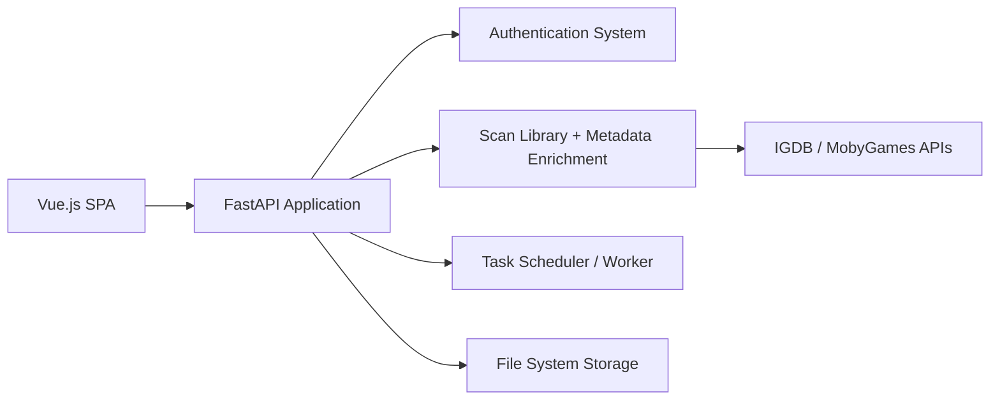

# rommapp/romm

> Self-hosted ROM manager and player, with metadata, save syncing and web emulation.

## The problem
A scattered ROM collection is hard to catalog, enrich and play from several devices.

## What it actually does
Vue.js SPA and FastAPI backend with PostgreSQL and Redis. Scans the library and enriches it via IGDB, Screenshot, LaunchBox, MobyGames, SteamGridDB and RetroAchievements. Plays in the browser with EmulatorJS and RuffleRS, syncs saves, includes a ROM patcher, OIDC SSO and per-user permissions. Official Playnite and Android apps, handheld firmwares.

## How it is wired

## Trying it
The README contains no command: it points to the "Quick Start Guide" in the documentation.

## Cost and gotchas
Free, with no tracking or paid features. Metadata comes from third-party APIs (keys may be needed). The README shows a Hostinger hosting link that gives a share of revenue to the project.

## What it is not
Provides no ROM or BIOS; the legal framework is your responsibility.

## Alternatives
Gaseous, another ROM manager with a web emulator, cited in "Our Friends".

## For you
Ignore: a retrogaming tool unrelated to data/AI/MLOps, even though it is well built and under AGPL-3.0.
